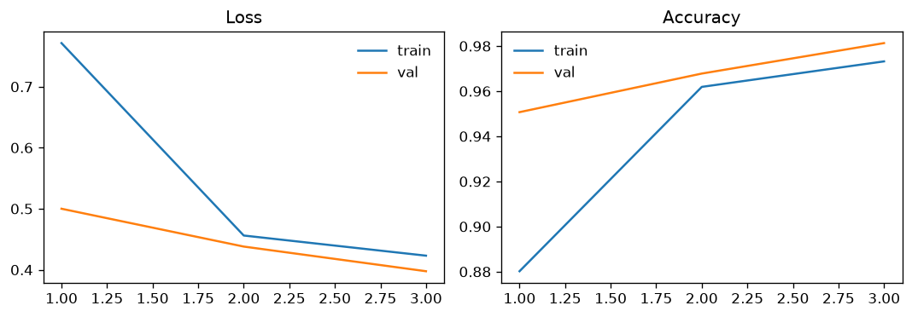
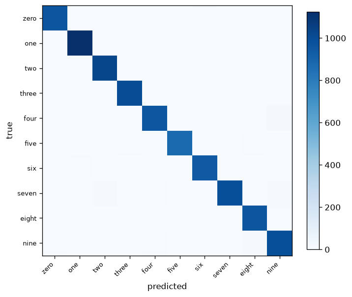
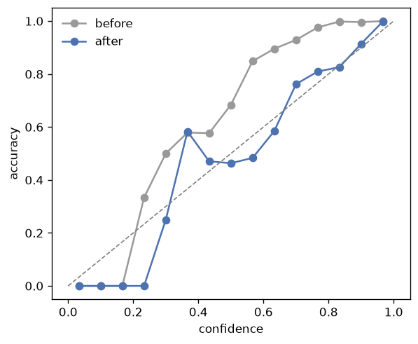
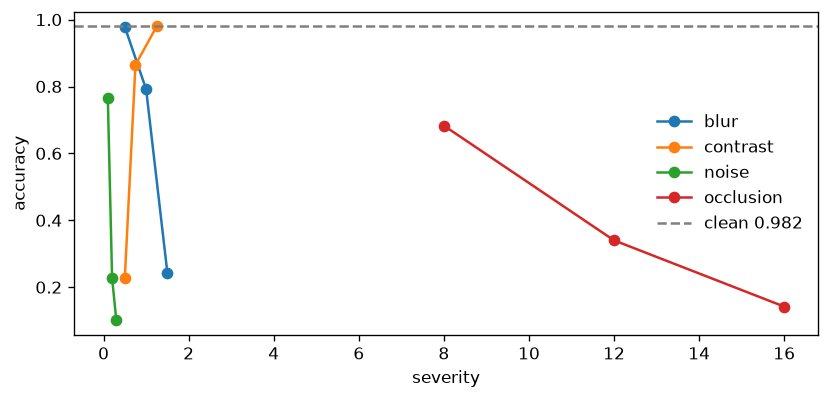
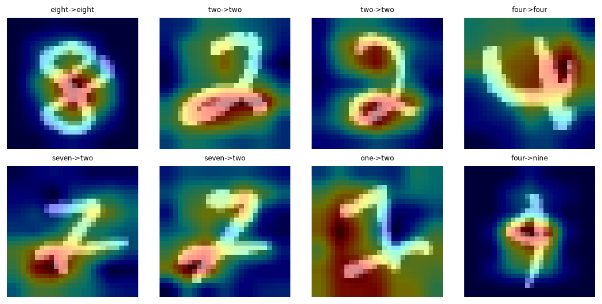

# MNIST CNN

A compact convolutional neural network for handwritten-digit recognition, with
temperature-scaling calibration, Grad-CAM explanations and a corruption
robustness sweep. Training runs in a few minutes on a laptop CPU.

## Results

| Metric | Value |
| --- | --- |
| Test accuracy | **98.22%** |
| Macro F1 | **0.9822** |
| Parameters | 94,186 |
| Training time | 265 s (3 epochs, 12 CPU threads) |
| ECE before calibration | 0.0657 |
| ECE after calibration | **0.0040** (T = 0.5146) |
| Accuracy at ≥90% confidence | **99.74%** (94.6% coverage) |

Per-class F1 ranges from 0.967 (`nine`) to 0.991 (`one`). The most frequent
confusion is `four` predicted as `nine` (20 cases). Under corruption on a
stratified 1,000-image slice, clean accuracy is 98.2%; Gaussian noise at
σ = 0.30 drops it to 10.1%, Gaussian blur at σ = 1.0 to 79.2%, and a central
16-pixel occlusion to 14.2%.







## Quickstart

```bash
python -m pip install -r requirements.txt
python run.py all
python run.py check
python run.py dashboard
```

The pipeline downloads MNIST (~11 MB), trains for 3 epochs, writes eight
figures to `reports/figures/` and a dashboard feed to `artifacts/dashboard/`.

## Project layout

```
src/mnistvision/   data, model, training, evaluation, Grad-CAM, robustness
dashboard/         Streamlit demo
tests/             pytest suite
reports/           metrics, figures, report and model card
artifacts/         trained checkpoint and dashboard feed
```

## Tests

```bash
python -m pytest -q
python -m ruff check src tests dashboard run.py
```

## Licence

MIT. See `docs/METHODOLOGY.md`, `docs/DECISIONS.md` and `docs/DEPLOYMENT.md`.
